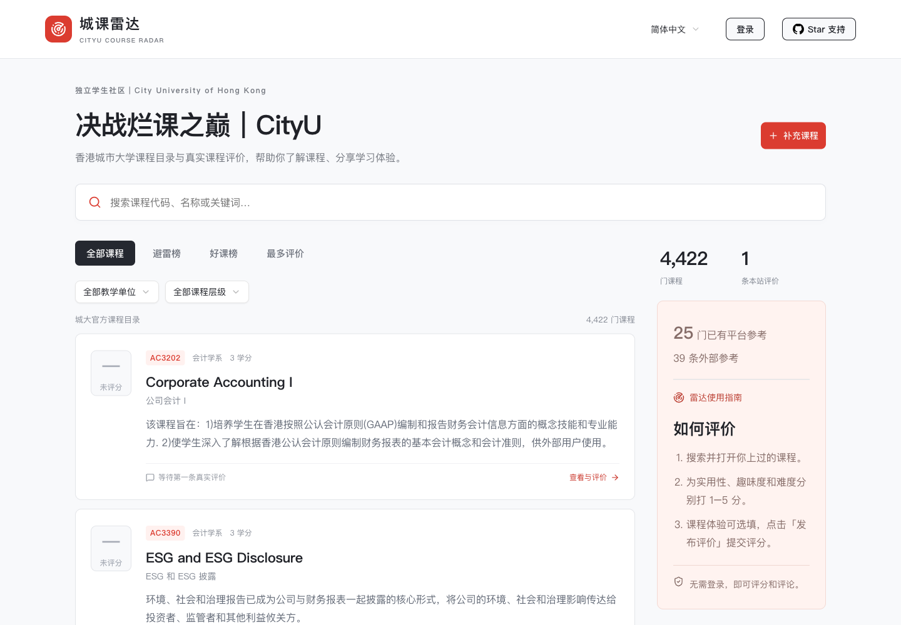

# CityU Course Radar · 城课雷达

[简体中文](README.md) · **[Visit CityU Course Radar](https://cityuhk.uwaylab.com)**

See the course details and hear from other students before you choose.

CityU Course Radar is an independent course guide and review community for students at City University of Hong Kong (CityUHK). Find courses, read ratings and public course reflections, or share your own experience to help the next student decide.

_Course browser in Chinese, captured in October 2026. Visit the site for current course and review data._

## What you can do here

- **Find a course**: search by course code or title, filter by department and undergraduate or postgraduate level, and open course descriptions and official links.
- **Hear from other students**: read usefulness, interest and difficulty ratings alongside course experiences. You can rate a course without signing in; a written review is optional.
- **Get another perspective**: browse curated references from Xiaohongshu, Dcard and public course reflections, then follow the links to the original posts. External ratings stay separate from Radar scores.
- **Browse in your preferred language**: the interface supports Simplified Chinese, Traditional Chinese and English, with machine-assisted Chinese translations of course information. Student reviews stay in the language they were written in.

## Start with a course you care about

1. **[Visit the site](https://cityuhk.uwaylab.com)** and search for a course code or title.
2. Open the course page and compare its official description, Radar reviews and external reflections.
3. If you have taken the course, leave ratings and, if you like, a few things you wish you had known beforehand: the workload, assessment format or what you enjoyed learning.

Browsing, rating and commenting require no login. Anonymous reviews can be edited in the same browser; clearing cookies may remove that access. New reviews posted while signed in can be managed across browsers. If a course is missing, sign in with Google to add it.

Spotted incorrect course information or something that is awkward to use? [Let us know](https://github.com/yqia03/cityu-course-radar-public/issues).

## Reading ratings and rankings

Each dimension uses a 1–5 scale. The overall score is **(usefulness + interest + 6 − difficulty) ÷ 3**. Higher difficulty lowers this score, but a challenging course is not necessarily a bad course: consider your interests and the written reviews too.

A course needs **at least 3 visible Radar reviews** to enter the best/worst course rankings. External ratings do not contribute to Radar averages. Anonymous reviews do not verify enrollment or guarantee one vote per person, so treat scores as a reference.

## Materials and official past papers

Course pages include **free links to official past-paper searches** in CityU LibraryFind, using the course code. Opening these links requires no Radar account. Restricted papers still require university authentication on the official site, and availability depends on the library's holdings.

Hosted material uploads are currently paused, verified on 31 October 2026. Downloading published files requires Google sign-in and unlocking them under the [site's points rules](https://cityuhk.uwaylab.com/points); check each course page for available materials. Official exam PDFs have not been imported in bulk.

## About the data and the project

- **Course catalogue**: the bundled 2026/27 official undergraduate and postgraduate catalogue snapshot contains 4,422 distinct course codes, including 170 GE courses. Inclusion does not mean a course is offered this term; consult the official [undergraduate](https://www.cityu.edu.hk/catalogue/ug/current/catalogue/B/B_course_index_full.htm) or [postgraduate](https://www.cityu.edu.hk/catalogue/pg/current/catalogue/TP/TP_course_index_full.htm) catalogue for current information.
- **Chinese translations**: course titles and descriptions use machine-assisted translations and may contain errors. Check the original through each course's official link.
- **External references**: maintainers curate public posts and preserve attribution and the original rating scale. This is neither a live feed nor a representative survey. Experiences may also vary by term and instructor.
- **Independence**: this is an independent student project, unaffiliated with City University of Hong Kong. It was inspired by the [University of Melbourne course ranking project](https://unimelbwall.com/worst-ten).

## For developers

Contributions to course information, translations and the browsing experience are welcome. This repository publishes the source code and course snapshots; live user data and production configuration are not included.

- [Development guide (Chinese)](docs/development.md): local setup, checks, project structure and links to deployment documentation.
- [Contributing](CONTRIBUTING.md) · [Public repository guide (Chinese)](docs/public-repository.md)

Project-owned code uses the [MIT license](LICENSE). See [third-party notices](THIRD_PARTY_NOTICES.md) for course material, external posts and dependency rights.
